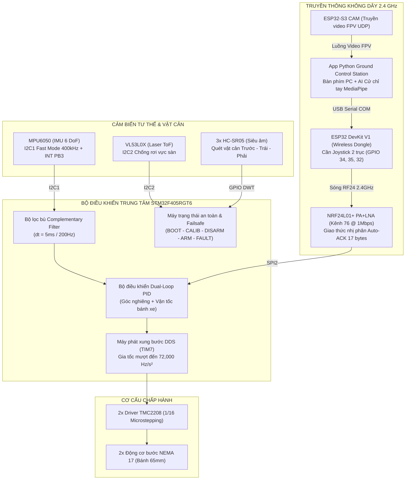

# 🤖 ROBOT CÂN BẰNG 2 BÁNH TỰ HÀNH — STM32F405 & ESP32 FPV
> **Đồ án môn học:** Thực Hành Thiết Kế Hệ Thống Nhúng  
> **Trường Đại học Công nghệ Thông tin – ĐHQG-HCM (UIT)**

---

## 📌 LIÊN KẾT TRỰC QUAN (VIDEO DEMO & SLIDE BÁO CÁO)

Dành cho người đọc, giảng viên và hội đồng chấm điểm muốn xem nhanh kết quả và báo cáo đề tài:

* 🎥 **Video Demo Vận Hành Thực Tế:**  
  👉 [**[BẤM VÀO ĐÂY ĐỂ XEM VIDEO DEMO TRÊN YOUTUBE / DRIVE]**](https://www.youtube.com/watch?v=YOUR_VIDEO_ID_HERE)  
  *(Mô tả: Video quay cận cảnh xe tự cân bằng tại chỗ, di chuyển tiến/lùi, bẻ lái 8 hướng, thử nghiệm né vật cản ADAS và chống rơi mép sàn ToF)*

* 📊 **Slide Thuyết Trình Báo Cáo (Canva):**  
  👉 [**[BẤM VÀO ĐÂY ĐỂ MỞ SLIDE THUYẾT TRÌNH CANVA]**](https://www.canva.com/design/YOUR_CANVA_LINK_HERE)  
  *(Mô tả: Toàn bộ slide thuyết trình đồ án với hình ảnh thiết kế 3D, sơ đồ khối, lưu đồ thuật toán và kết quả thử nghiệm)*

---

## 👥 THÔNG TIN NHÓM THỰC HIỆN

| STT | Họ và Tên | MSSV | Vai trò chính trong dự án |
|:---:|---|:---:|---|
| **1** | **Nguyễn Tiến Thành** *(Kazato-ce)* | [Điền MSSV] | Trưởng nhóm, Thiết kế kiến trúc Firmware STM32, Vòng cân bằng PID, Tích hợp cảm biến IMU & DDS Stepper |
| **2** | **Đặng Thế Tứ** *(dangthetu)* | [Điền MSSV] | Thiết kế phần cứng mạch, Hệ thống truyền hình ảnh FPV Camera UDP, Ground Control Station (GCS) Python |
| **3** | **Phan Minh Quân** *(minhquan1120006)* | 24521428 | Phát triển cầu nối không dây NRF24, Hệ thống đo khoảng cách siêu âm & Thử nghiệm thực tế |

* **Giảng viên hướng dẫn:** [Tên Thầy/Cô Hướng Dẫn]
* **Năm học / Học kỳ:** Học kỳ 1 — Năm học 2026 - 2027

---

## 🌟 ĐẶC ĐIỂM NỔI BẬT CỦA HỆ THỐNG

1. **Vòng điều khiển cân bằng thời gian thực 200 Hz (5 ms):**
   * Sử dụng STM32 Hardware Timer (TIM6) chạy ngắt cứng chu kỳ chính xác 5 ms, không phụ thuộc vào vòng lặp `while(1)`.
   * Hợp nhất cảm biến góc nghiêng bằng **Bộ lọc bù (Complementary Filter)** giữa Con quay hồi chuyển (Gyro) và Gia tốc kế (Accelerometer) từ **MPU6050** qua I2C1 400 kHz.
2. **Bộ tạo xung vi bước DDS mượt mà (TMC2208 + NEMA 17):**
   * Thuật toán phát xung độc lập 2 bánh theo gia tốc giới hạn (`72,000 Hz/s²`), loại bỏ hoàn toàn tiếng gằn máy và hiện tượng trượt bước.
3. **Hệ thống hỗ trợ an toàn & Trợ lái thông minh (ADAS):**
   * **Chống rơi bờ vực (Cliff Detection):** Cảm biến Laser ToF **VL53L0X** (I2C2) phát hiện mép sàn hở (> 45 cm) và tự động giật lùi khẩn cấp.
   * **Cụm 3 cảm biến siêu âm HC-SR05:** Đo khoảng cách 3 hướng (Trước, Trái, Phải) theo máy trạng thái phi chặn (Non-blocking DWT timer), tự động hãm ga và giữ khoảng cách sườn an toàn.
4. **Đa dạng phương thức điều khiển không dây tầm xa (NRF24L01+ 2.4 GHz):**
   * **Trạm mặt đất Python GCS:** Điều khiển bàn phím máy tính (W/A/S/D/Space), đồ thị dữ liệu Pitch & Vận tốc trực tiếp.
   * **Điều khiển cử chỉ AI bàn tay:** Tích hợp mô hình Google MediaPipe Hand Tracking nhận diện chuyển động bàn tay qua webcam.
   * **Cần Joystick Analog 2 trục độc lập:** Cắm trực tiếp trên ESP32 DevKit V1 (GPIO 34, 35, 32) để điều khiển xe ngoài trời mà không cần laptop.
   * **Hệ thống FPV Camera:** ESP32-S3 CAM truyền luồng video thời gian thực độ trễ thấp về trạm điều khiển hoặc màn hình cầm tay LCD ST7789V.

---

## 📐 SƠ ĐỒ KIẾN TRÚC HỆ THỐNG



---

## 🔌 SƠ ĐỒ NỐI CHÂN PHẦN CỨNG (PINOUT)

| Thiết bị | Tín hiệu | Chân STM32F405 | Cấu hình & Ghi chú |
|---|---|:---:|---|
| **TMC2208 (Chung)** | EN | **PA0** | GPIO Output (Mặc định HIGH = Tắt an toàn khi boot) |
| **TMC2208 Trái** | STEP / DIR | **PA1 / PA2** | Xung Timer AF / GPIO Output |
| **TMC2208 Phải** | STEP / DIR | **PA3 / PA4** | Xung Timer AF / GPIO Output |
| **MPU6050** | SCL / SDA | **PB6 / PB7** | I2C1 (Fast Mode 400 kHz) |
| **MPU6050** | INT | **PB3** | EXTI3 (Chỉ đặt cờ báo dữ liệu mới) |
| **NRF24L01** | SCK / MISO / MOSI | **PB13 / PB14 / PB15** | SPI2 (Full-Duplex Master) |
| **NRF24L01** | CE / CSN | **PB8 / PB9** | GPIO Output |
| **VL53L0X** | SCL / SDA | **PB10 / PB11** | I2C2 |
| **HC-SR05 Trước** | TRIG / ECHO | **PC0 / PC1** | Output / Input phi chặn |
| **HC-SR05 Trái** | TRIG / ECHO | **PC2 / PC3** | Output / Input phi chặn |
| **HC-SR05 Phải** | TRIG / ECHO | **PC4 / PC5** | Output / Input phi chặn |
| **Debug ST-Link** | SWDIO / SWCLK | **PA13 / PA14** | Serial Wire Debug (Giữ PB3 cho MPU6050) |

---

## 📂 CẤU TRÚC THƯ MỤC DỰ ÁN

```
XECANBANGFINAL/
├── App/                                # Mã nguồn tầng ứng dụng xe cân bằng trên STM32 (HAL)
│   ├── Inc/                            # File cấu hình: config.h, board_config.h, protocol.h, balance.h...
│   └── Src/                            # File triển khai: balance.c, imu_mpu6050.c, stepper_tmc2208.c...
├── App_python/                         # Trạm điều khiển mặt đất (Ground Control Station) trên máy tính
│   ├── app.py                          # Ứng dụng GCS chính (Giao diện điều khiển, hiển thị telemetry & video)
│   ├── hand_controller.py              # Điều khiển xe bằng cử chỉ bàn tay qua Camera AI MediaPipe
│   ├── cam_fpv_stream.py               # Bộ giải mã và hiển thị luồng video FPV độ trễ thấp
│   ├── models/hand_landmarker.task     # Mô hình AI nhận diện khớp tay
│   └── run_app.bat                     # File kích hoạt nhanh ứng dụng Python chỉ với 1 click
├── ESP32_DevKit_NRF24/                 # Firmware tay cầm / Dongle USB không dây cho ESP32 DevKit V1
│   └── ESP32_DevKit_NRF24.ino          # Xử lý lệnh từ PC hoặc Cần Joystick 2 trục (GPIO 34, 35, 32)
├── ESP32_S3_Cam_UDP/                   # Firmware cho camera ESP32-S3 truyền video FPV qua sóng WiFi
├── ESP32_DevKit_ST7789V_Display_FPV/   # Firmware hiển thị FPV lên màn hình LCD di động ST7789V
├── Core/                               # Mã nguồn khởi tạo ngoại vi phần cứng STM32 từ STM32CubeMX
├── Drivers/                            # Thư viện chuẩn ST HAL Driver & CMSIS
├── CMakeLists.txt                      # Kịch bản biên dịch CMake chuẩn của dự án
└── README.md                           # Tài liệu thuyết minh dự án
```

---

## 🚀 HƯỚNG DẪN BIÊN DỊCH VÀ KHỞI CHẠY

### 1. Biên dịch Firmware STM32F405
Yêu cầu hệ thống đã cài đặt `arm-none-eabi-gcc`, `cmake` và `ninja`:
```bash
# Cấu hình dự án bằng CMake Preset Debug
cmake --preset Debug

# Biên dịch chương trình
cmake --build build/Debug
```
File thực thi nạp qua ST-Link: `build/Debug/XECANBANGFINAL.bin` hoặc `XECANBANGFINAL.hex`.

### 2. Nạp Firmware ESP32 DevKit NRF24 Dongle
* Mở Arduino IDE, mở file `ESP32_DevKit_NRF24/ESP32_DevKit_NRF24.ino`.
* Cài đặt thư viện: `RF24` của TMRh20.
* Chọn board: `ESP32 Dev Module` và nạp qua cổng USB COM.

### 3. Khởi chạy Trạm điều khiển Máy tính (App Python GCS)
* Vào thư mục `App_python`:
```bash
cd App_python
pip install -r requirements.txt
python app.py
```
*(Hoặc nhấp đúp chuột vào file `run_app.bat` trên Windows).*

---

## 🛡️ NGUYÊN TẮC AN TOÀN VẬN HÀNH (SAFETY FIRST)
1. **Khởi động an toàn (Safe Boot):** Khi cấp nguồn, chân driver motor (PA0) luôn ở mức HIGH (ngắt động cơ). Động cơ chỉ được kích hoạt (ARM) khi xe được dựng thẳng trong góc $\pm 8^\circ$ và giữ ổn định ít nhất 2 giây.
2. **Ngắt khẩn cấp tự động (Fall Cut-off):** Nếu xe nghiêng quá ngưỡng $\pm 42^\circ$ (do va chạm mạnh hoặc ngã), hệ thống lập tức ngắt xung bước và nhả driver motor để bảo vệ mạch công suất.
3. **Mất sóng tự dừng (Radio Watchdog):** Nếu mất tín hiệu điều khiển quá $1000\text{ ms}$, tốc độ xe sẽ tự động hạ về 0 và giữ cân bằng tại chỗ.
